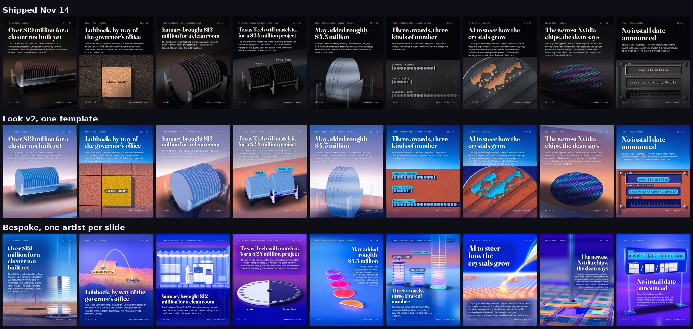

# Bespoke proof, Nov 14 2026

The Nov 14 story, copy and figures, drawn by nine slide artists working in parallel on one spine
chassis (`assets/js/deck/2026-11-14-waferbench-bespoke.js`). Each frame was conceived on its own,
judged cold by its own critic, and reworked once. Copy the method in `knowledge/carousel/BESPOKE.md`,
never the pictures.



## What is here

| Path | What it is |
| --- | --- |
| `before_after.webp` | The shipped Nov 14 deck, the look v2 proof (one template) and this deck, row by row. |
| `2026-11-14/contact.webp` | The nine bespoke frames after one rework round. |
| `2026-11-14/contact-round1.webp` | The same nine frames as the artists first handed them back. |
| `2026-11-14/briefs/slide-NN.md` | The slide brief each artist worked from. |
| `2026-11-14/briefs/slide-NN.concepts.md` | Each artist's three concepts and the one it picked. |
| `2026-11-14/slides/slide-NN.html` | The frames. Render them with the command below. |

```bash
python3 .claude/skills/carousel-engine/render.py --slides-dir examples/bespoke-proof/2026-11-14/slides --out-dir /tmp/bespoke --timeout 300000
python3 scripts/carousel/distinct_check.py --render-dir /tmp/bespoke
```

## What it measured

| | Last 14 shipped decks | Bespoke, round 1 | Bespoke, after rework |
| --- | --- | --- | --- |
| Adjacent similarity (lower is more different) | 0.452 to 0.567 | 0.377 | 0.302 |
| Headline places across nine frames | 1 or 2 | 4 | 6 |
| Longest run of frames with the headline in one place | 4 to 9 | 3 | 1 |
| `distinct_check.py` | FAIL on all 14 | FAIL | OK |
| Cold slide critic, per frame | not run | 4.8 to 7.6 | 5.8 to 7.2 |

qa.py ends with 0 FAIL on all nine frames, and `value_register.py --look v2 --probe` passes.

## What it did not reach

No frame reached the critic's 8.0 ship bar. The artists scored themselves about 1.5 points above the
cold critic, which is why the critic stage stays. What held the craft down was the engine kit
(capsule figures, flat discs, plain cylinders and pastel gradients where the critic asked for real
silicon, glass and machined parts), not the process. The next lift is the model and material
library.
